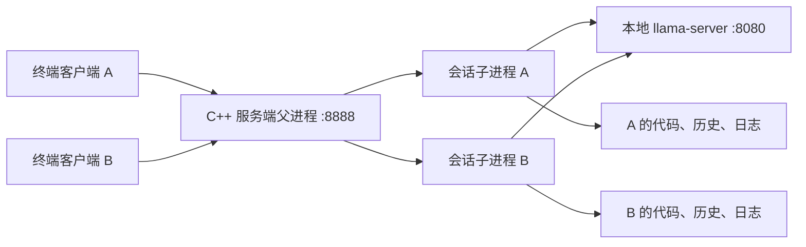

# C++ 极简 Coding Agent 实现计划

状态：核心已完成；默认业务模板为空的 C++ 项目，支持从需求生成程序及后续修改。2026-10-10 增加 TUI、底部目录 / token / 模型状态栏、可展开的工具卡片，以及直接使用指定目录。全部在 macOS 本机编译、运行和验收，不使用 Docker。启动方式见 [README.md](README.md)，实际记录见 [TESTING.md](TESTING.md)。

## 1. 做出什么

实现一个终端编程助手：用户提出程序需求，助手在空的 C++ 项目中创建源文件，实际编译并运行自测，再根据错误继续修复。客户端能实时看到回答、工具执行状态和构建输出，并在同一连接中继续修改生成的程序。

默认模板只包含只读 Makefile、构建说明和空的 `src/`，不预置业务程序。源代码控制在几个文件内。例如：

1. “生成一个从标准输入读取整数并升序输出的程序，包含自测。”
2. “给刚才的程序增加降序选项，保留默认行为。”
3. “生成一个统计文本行数、词数和字节数的命令行工具。”

实现重点是完成真实的“需求 → 创建代码 → 编译自测 → 修复 → 继续修改”循环。首版范围限于小型 C++ 项目、终端客户端和四个工具；GUI、IDE 插件、多 Agent、检索系统和任意 shell 工具留到后续。

## 2. 技术选择

| 部分 | 首版选择 |
| --- | --- |
| 实现语言 | 客户端、应用服务器、Agent 循环、工具和测试使用 C++17 |
| 系统接口 | POSIX socket、fork、pipe、exec、poll、waitpid，以及文件读写；兼容 Linux/macOS |
| 模型 | 使用已有的 `../Qwen3.5-4B-GGUF/Qwen3.5-4B-Q8_0.gguf` |
| 推理服务 | 独立的本地 llama-server；Mac 使用 Metal，Linux 可使用 CPU |
| 模型通信 | libcurl 调用本机 `/v1/chat/completions`，开启流式输出和工具调用 |
| JSON / 构建 | nlohmann/json、CMake；依赖固定版本，不引入 Agent 框架 |
| 运行方式 | 模型服务、C++ 应用服务器、C++ 终端客户端分别启动 |

模型接口的流式输出、工具调用及并行槽以 [llama.cpp server 文档](https://github.com/ggml-org/llama.cpp/blob/master/tools/server/README.md)和[工具调用文档](https://github.com/ggml-org/llama.cpp/blob/master/docs/function-calling.md)为依据，开工时核对本机版本的实际行为。

## 3. 进程、并发与会话隔离



- 父进程负责监听、接受连接和回收子进程；每个连接对应一个 `fork()` 子进程，子进程独立初始化模型 HTTP 客户端。
- 服务端生成唯一 `session_id`，默认将空项目模板复制到 `sessions/<session_id>/workspace/`。客户端可在首次提问前用 `--workdir` 直接选择项目目录；同目录只允许一个活跃连接，历史与日志仍按会话隔离。
- 对话历史保存在该子进程的内存中，同时写入独立的 `history.jsonl`；运行事件写入 `events.jsonl`，完整构建输出写入单独文件。
- 每次模型请求显式携带本连接的历史，包括工具调用及其结果。会话归属由应用层维护，不依赖模型槽记住客户端身份。
- 客户端断开后，取消本会话的 HTTP 请求，终止并回收本会话的构建进程组。父进程继续接收连接，其他会话继续运行。
- 首版验收目标是两个客户端同时生成；客户端连接内一次处理一个任务，任务完成后可以继续提问。

## 4. 四个工具与 Agent 循环

| 工具 | 行为 | 首版限制 |
| --- | --- | --- |
| `list_files()` | 列出当前项目的相对文件路径 | 排除构建产物，限制数量和目录深度 |
| `read_file(path, start, count)` | 按行读取并返回行号 | 每次最多 100 行、4 KiB；超出时标明截断 |
| `write_file(path, content)` | 创建或完整替换源文件 | 只写所选工作目录的 `src/`；单文件上限 64 KiB；临时文件加原子替换 |
| `build_and_test()` | 编译项目并执行生成程序的 `--self-test` | 固定构建入口；返回退出码、输出及超时状态；构建和测试合计上限 30 秒 |

工具仅访问当前工作区，拒绝绝对路径、`..` 越界和符号链接跨目录访问。构建规则及自定义模板的外部验收测试可读但不可由工具修改。默认空模板的自测由模型编写在 `src/`，成功表示实际编译和自测退出码为零，不代表独立证明全部需求正确。

默认模板提供固定的 `make test` 入口，将全部 `src/*.cpp` 编译为 `build/app`，运行 `build/app --self-test`，不等待标准输入。构建使用 `fork + pipe + exec`，参数由程序指定；构建输出实时显示，反馈给模型的内容最多 4 KiB，完整输出保留在日志中。工作区隔离用于课程演示，不将它称为执行任意不可信代码的系统沙箱。

每个任务按以下循环运行：

1. 将用户消息加入本连接历史，检查完整请求的 token 预算。
2. 请求模型，收到可见文本增量就转发给客户端。
3. 收齐工具调用参数后解析 JSON、校验工具名和参数，再顺序执行工具。
4. 将结构化工具结果加入历史，再请求模型；编译失败时，模型可读取错误并修改代码。
5. 模型给出最终回答或达到上限后结束任务，连接保留，等待下一条消息。

单任务最多 8 次模型请求，单次请求最多 180 秒，任务总时限 8 分钟；参数错误、工具失败、输出截断和次数耗尽都明确返回。截断的工具参数不执行，构建是否成功以真实退出码和测试结果为准。

## 5. 通信与流式显示

客户端与应用服务器使用 TCP，消息格式为 **4 字节网络字节序长度 + UTF-8 JSON**，单帧上限 1 MiB。所有任务事件携带 `request_id`，连接建立时返回 `session_id`。

| 方向 | 消息类型 |
| --- | --- |
| 客户端 → 服务端 | `user_message`、`quit` |
| 服务端 → 客户端 | `hello`、`text_delta`、`tool_start`、`tool_result`、`build_output`、`task_done`、`error` |

- 协议处理短读、短写、TCP 分包和粘包，以及 `EINTR`、断连和 `SIGPIPE`。
- libcurl 回调的数据块不等于完整 SSE 事件；先增量解析 SSE，再组装文本与工具调用参数。
- 客户端接收文本后立即显示并刷新，保留跨块的不完整 UTF-8 字节。TUI 底部固定显示目录、已测量的 token 数与模型；多行输入自动换行，粘贴后手动发送；工具默认折叠，展开后显示完整 JSON，可鼠标双向滚动。顶部显示本轮执行阶段和实际耗时。网络帧和鼠标报告增量解析，避免未收齐消息时阻塞界面。
- `task_done` 表示本轮结束，并携带成功、失败、取消或达到限制的状态；涉及代码改动时，只有最后一次写文件之后的编译和测试通过，才能标记成功。

## 6. 16K 上下文预算

原有模型配置使用 `--ctx-size 16384 --parallel 1`。本项目启动脚本已使用总上下文 **16384**、并行槽 **2**；本机 `/slots` 已核实每槽 **8192**。

代码生成版本的预算为：完整输入最多 5632 tokens，生成最多 2048 tokens，预留 512 tokens。总计每槽 8192，两个槽共 16384。此前用于小幅修改的 6144 / 1536 分配已调整，以便输出完整源码。输入计数必须包含系统提示、工具定义、聊天模板、此前对话和工具结果，使用本机模型 tokenizer 计数，不能把字符数当作 token 数。

代码按需读取，构建输出限长（保留开头和末尾错误）。预算不足时明确停止本轮并提示新建连接，原始历史和日志保留；首版不自动删除旧对话或用摘要替代历史。如果代码已通过测试、仅缺收尾说明，直接返回已验证结果，不再请求模型。这样同一连接内成功处理的新问题始终包含此前对话。

默认关闭 thinking，先验证短任务的工具调用与修复表现，再根据实测调整采样参数。模型仅加载一份，支持两个请求并行解码；实际速度由本机测试记录，不预设性能数字。

## 7. 计划目录

实现按照以下小型目录结构组织。

```text
coding-agent/
├── PLAN.md
├── CMakeLists.txt
├── README.md
├── src/
│   ├── client.cpp          # 参数、指定目录、文本 / JSON / TUI 模式
│   ├── client_tui.cpp      # ncurses、底部状态栏、工具折叠、宽字符输入
│   ├── client_tui.hpp      # 客户端显示状态与界面接口
│   ├── server.cpp          # TCP 监听、fork、会话初始化与回收
│   ├── protocol.cpp        # 消息封装及完整收发
│   ├── agent.cpp           # 历史、预算、工具循环
│   ├── model_client.cpp    # 本地 HTTP、SSE、工具调用组装
│   ├── tools.cpp           # 文件工具、构建与测试子进程
│   └── common.hpp          # 小型公共类型和接口
├── templates/cpp/         # 空 src/、固定 Makefile 和构建说明
├── tests/                 # C++ 协议/集成测试及模拟模型响应
└── sessions/              # 运行时生成的会话工作区、历史和日志
```

## 8. 实施顺序与验收

| 阶段 | 工作 | 通过条件 |
| --- | --- | --- |
| 1. 模型与工具可行性 | 使用现有权重验证计数、流式工具调用、写文件、编译及错误反馈 | 至少跑通一次真实修改与测试；记录 4B 模型的实际表现 |
| 2. 客户端与并发服务器 | 实现协议、每连接子进程、独立工作区和日志 | 两个客户端收发互不影响；关闭一个不影响另一个 |
| 3. 接入完整 Agent | 串联流式模型响应、四个工具、多轮历史和预算限制 | 同一连接连续修改项目，工具结果能驱动下一步修复 |
| 4. 整体验收与文档 | 在 macOS 本机验证异常路径，整理启动说明和答辩演示 | 以下验收项有实际运行记录；不要求 Docker/Linux 环境 |

需要证明的效果：

- **真实文件操作**：查看 Agent 修改后的源文件，实际编译、运行测试，能够展示修改前后的差异。
- **生成及修复**：从空项目创建实际源码；真实编译错误或自测失败时，工具输出能驱动修改。
- **连续提问**：第二轮引用“刚才的程序”继续增加功能，连接不重建，历史顺序完整。
- **上下文隔离**：A、B 设置不同的变量名或功能要求，后续提问沿用各自要求。
- **真实并发流式输出**：两个请求执行时间重叠，两端都在各自 `task_done` 前收到多个文本增量；不会等一端全部完成才开始另一端。
- **断连与日志隔离**：生成或构建中关闭 A，B 继续输出；会话 PID、源文件、历史和构建日志分别可查。
- **边界处理**：分包/粘包、中文分块、非法路径、构建超时、模型不可用、工具参数截断和上下文超限均给出明确结果。

协议与异常处理用确定性的模拟响应验证，编程能力另用当前本地模型实测。只有前者通过不代表模型能够完成演示任务；模型失败也必须如实显示并保存日志。

最终交付包括可编译的 C++ 源码、固定依赖与构建方式、三部分启动命令、演示项目、验收记录，以及便于撰写课程报告的架构和关键系统调用说明。
